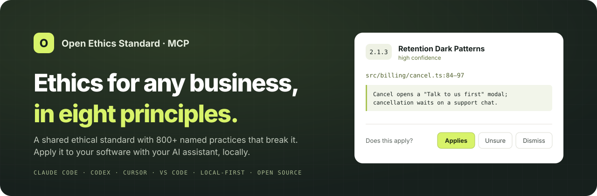
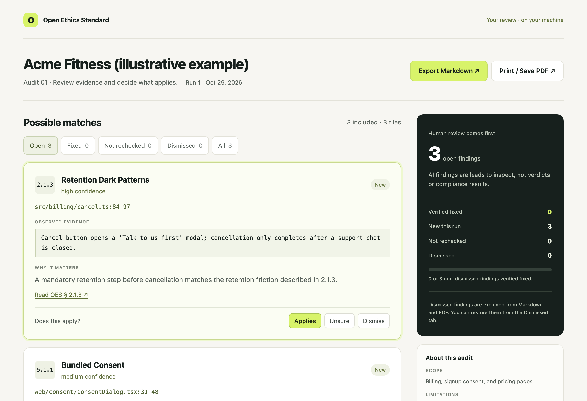

<p align="center">
  
</p>

<p align="center">
  <a href="LICENSE"></a>
  <a href="LICENSE-OPEN-ETHICS-STANDARD.md"></a>
  <a href="https://github.com/ike5/open-ethics-standard/actions/workflows/validate-standard.yml"></a>
  <a href="https://www.npmjs.com/package/open-ethics-standard-mcp"></a>
</p>

<p align="center">
  <a href="https://ike5.github.io/open-ethics-standard/"><b>Website</b></a> ·
  <a href="OPEN-ETHICS-STANDARD.md"><b>Read the standard</b></a> ·
  <a href="docs/agent-setup.md"><b>Setup guide</b></a> ·
  <a href=".github/CONTRIBUTING.md"><b>Contribute</b></a>
</p>

**A shared ethical standard for any business.** The Open Ethics Standard (OES) says how a business should treat the people it serves, employs, buys from, and affects, and names the specific ways that goes wrong. It covers every industry: hotels, gyms, lenders, employers, manufacturers, and software.

## The eight principles

| Principle | In short |
| --- | --- |
| **Honesty** | Tell people the truth about prices, products, services, and claims. |
| **Autonomy** | People choose freely and knowingly, and can say no, change their mind, or leave. |
| **Privacy** | Collect only what is needed, use it only as agreed, and protect it. |
| **Fairness** | Treat people equally, do not discriminate, and keep services accessible. |
| **Care** | Protect vulnerable people; do not profit from distress, grief, or compulsion. |
| **Safety** | Do not sell known harms, keep service promises, and allow repair. |
| **Accountability** | Explain decisions, offer recourse, own mistakes, and protect people who speak up. |
| **Responsibility** | Workers, suppliers, communities, competitors, and the environment count too. |

Under them sit 804 named, numbered practices that break these principles, such as *Drip Pricing* (§ 1.1.1) or *Roach Motel Friction* (§ 2.1.3). [Read the standard](OPEN-ETHICS-STANDARD.md).

## Ways to use it

- **Cite it.** Name a harm precisely, with a number anyone can look up: "the cancellation flow breaks Autonomy, OES § 2.1.1."
- **Assess a business.** Work through each principle and the practices under it. Each practice has a plain description and examples from many industries.
- **Apply it to software.** The OES MCP lets your AI coding assistant review a project against the standard. It runs on your machine. Findings are leads for you to review, not verdicts or certifications, and a code review can only see what a product does, not how a company treats its workers or suppliers.

## Apply it to your software

**1. Add the MCP.** It needs Node.js 20+; no account or API key:

```sh
claude mcp add --scope user open-ethics-standard -- npx -y open-ethics-standard-mcp@latest
```

For Codex: `codex mcp add open-ethics-standard -- npx -y open-ethics-standard-mcp@latest`. For Cursor, VS Code, or other clients, add a stdio server with command `npx` and args `-y open-ethics-standard-mcp@latest` ([per-client commands](https://ike5.github.io/open-ethics-standard/#install)). On native Windows, use `cmd /c npx …`. To uninstall: `claude mcp remove --scope user open-ethics-standard`.

**2. Ask for a review.** Open your project and say:

```text
Review my project against the Open Ethics Standard.
```

You get back one link to an offline report, with every finding a click away:

<p align="center"></p>

## How it works

1. **Your AI reads your code.** The MCP gives it the principles, the catalog, and a review workflow.
2. **It matches behavior to OES practices**, citing files, lines, evidence, and the principle each one breaks.
3. **You decide.** Open the report, mark each finding **Applies**, **Unsure**, or **Dismiss**, and export to Markdown or PDF. After fixes, ask for a recheck; the same report tracks what's fixed.

## Your data

- The MCP runs on your machine. It never sends your code or findings anywhere, and your AI never has to download or run scripts to build the report.
- Reports are saved in `~/.local/share/open-ethics-standard/reports` (override with `OES_REPORT_DIR`).
- `@latest` picks up new catalog releases automatically. Pin a version (`open-ethics-standard-mcp@0.4.0`) if you'd rather update by hand.

## Contribute

Spotted a practice that's missing or wrong? Edit [`OPEN-ETHICS-STANDARD.md`](OPEN-ETHICS-STANDARD.md) and open a pull request, or [open an issue](https://github.com/ike5/open-ethics-standard/issues/new/choose). See [CONTRIBUTING.md](.github/CONTRIBUTING.md).

## License

Code is [MIT](LICENSE). The standard text and catalog are [CC BY-ND 4.0](LICENSE-OPEN-ETHICS-STANDARD.md).
