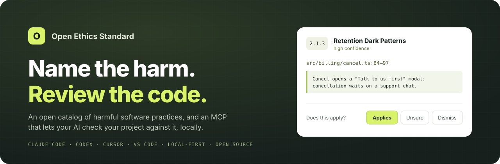
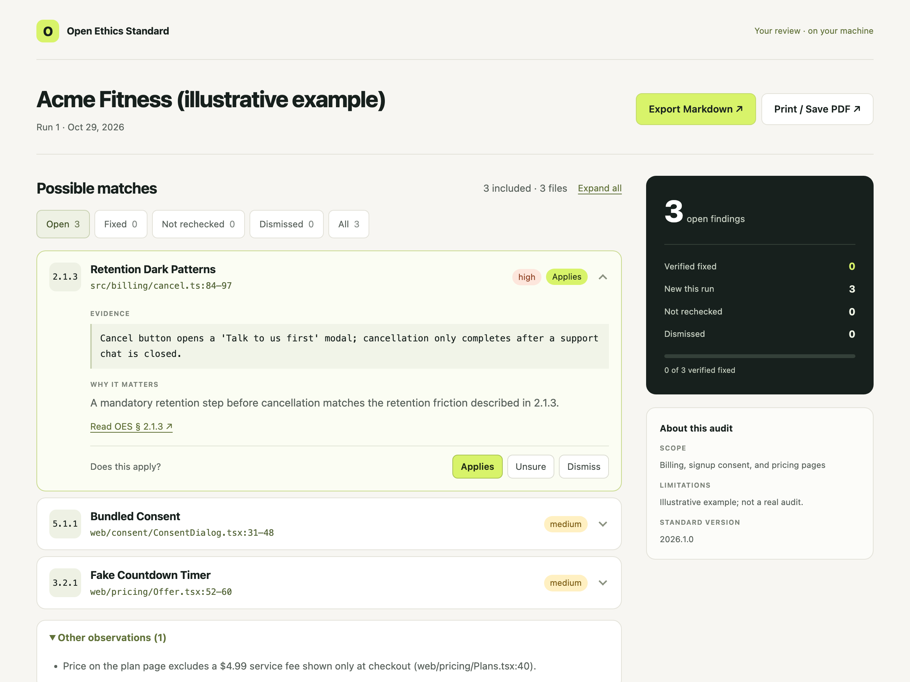

<p align="center">
  
</p>

<p align="center">
  <a href="LICENSE"></a>
  <a href="LICENSE-OPEN-ETHICS-STANDARD.md"></a>
  <a href="https://github.com/ike5/open-ethics-standard/actions/workflows/validate-standard.yml"></a>
  
</p>

<p align="center">
  <a href="https://ike5.github.io/open-ethics-standard/"><b>Website</b></a> ·
  <a href="OPEN-ETHICS-STANDARD.md"><b>Read the standard</b></a> ·
  <a href="docs/agent-setup.md"><b>Setup guide</b></a> ·
  <a href=".github/CONTRIBUTING.md"><b>Contribute</b></a>
</p>

**An MCP server that lets your AI coding assistant diagnose harmful practices in your code:** dark patterns, cancellation traps, bundled consent, and more. It's backed by the **Open Ethics Standard (OES)**, an open, citable catalog of 800+ named practices. It runs on your machine.

Findings are leads for you to review, not verdicts or certifications.

## Get started

**1. Add the MCP.** No install, account, or API key:

```sh
claude mcp add --transport http --scope user open-ethics-standard https://mcp.codebylevel.com/mcp
```

For Codex, Cursor, VS Code, or other clients, add a remote (HTTP) MCP server with the URL `https://mcp.codebylevel.com/mcp`. To uninstall: `claude mcp remove --scope user open-ethics-standard`.

**2. Ask for a review.** Open your project and say:

```text
Review my project against the Open Ethics Standard.
```

You get back one link to an offline report, with every finding a click away:

<p align="center"></p>

## How it works

1. **Your AI reads your code.** The MCP gives it the catalog and a review workflow.
2. **It matches behavior to OES practices**, citing files, lines, and evidence.
3. **You decide.** Open the report, mark each finding **Applies**, **Unsure**, or **Dismiss**, and export to Markdown or PDF. After fixes, ask for a recheck; the same report tracks what's fixed.

## Your data

- The MCP serves the catalog. It never sees your code.
- The report is built on your machine by [one small script](docs/oes-report.mjs), so findings stay local. Reports are saved in `~/.local/share/open-ethics-standard/reports`.
- Want everything offline? The [setup guide](docs/agent-setup.md#notes) covers running the MCP locally.

## Contribute

Spotted a practice that's missing or wrong? Edit [`OPEN-ETHICS-STANDARD.md`](OPEN-ETHICS-STANDARD.md) and open a pull request, or [open an issue](https://github.com/ike5/open-ethics-standard/issues/new/choose). See [CONTRIBUTING.md](.github/CONTRIBUTING.md).

## License

Code is [MIT](LICENSE). The standard text and catalog are [CC BY-ND 4.0](LICENSE-OPEN-ETHICS-STANDARD.md).
